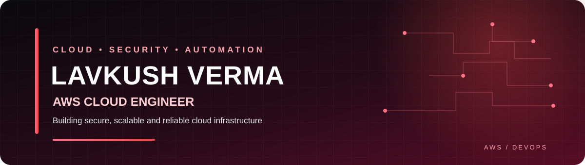

<div align="center">



### AWS CLOUD ENGINEER · CLOUD SECURITY · DEVOPS

Building secure, scalable, automated, and reliable cloud infrastructure.

[](https://github.com/lavkushverma)
[](https://aws.amazon.com/)
[](https://www.terraform.io/)

</div>

---

## 👨‍💻 About Me

I'm a Cloud / DevOps Engineer focused on AWS infrastructure, cloud operations, automation, and security. I work across infrastructure provisioning, networking, monitoring, security controls, troubleshooting, and operational improvement.

- ☁️ AWS infrastructure and multi-account governance
- 🔐 IAM, KMS, AWS Security Hub, AWS Config, and cloud security
- 🌐 VPC, ALB/NLB, Route 53, ACM, and AWS WAF
- ⚙️ Terraform, CI/CD, Docker, Kubernetes, and EKS
- 📈 CloudWatch, Grafana, Prometheus, and observability
- 🧰 Production support, troubleshooting, and root-cause analysis

## 🧰 Tech Stack

<p>
  
  
  
  
  
  
  
  
</p>

**AWS:** EC2 · VPC · S3 · IAM · KMS · CloudWatch · CloudTrail · Route 53 · ALB/NLB · EKS · ECS · ECR · Lambda · Organizations · SCP · Security Hub · GuardDuty · Inspector · AWS Config

**DevOps & Observability:** Terraform · Docker · Kubernetes · Jenkins · GitHub · GitLab CI/CD · Ansible · Grafana · Prometheus · Dynatrace

## 🚀 Featured Projects

<table>
<tr>
<td width="50%" valign="top">

### ☸️ EKS Infrastructure with Terraform
Reusable AWS infrastructure for EKS, VPC networking, managed node groups, and supporting cloud services.

**Focus:** AWS · Terraform · EKS

[↗ View repository](https://github.com/lavkushverma/EKS-Ready-Infrastructure-on-AWS-with-Terraform)

</td>
<td width="50%" valign="top">

### 🏗️ Production-Grade 3-Tier AWS Architecture
A reference architecture for subnet separation, load balancing, application tiers, and database integration.

**Focus:** VPC · ALB/NLB · RDS

[↗ View repository](https://github.com/lavkushverma/Production-Grade-3-Tier-AWS-Application-Architecture)

</td>
</tr>
<tr>
<td width="50%" valign="top">

### 📊 Grafana AWS Monitoring
Monitoring and observability with AWS CloudWatch and Grafana dashboards.

**Focus:** CloudWatch · Grafana · Alerts

[↗ View repository](https://github.com/lavkushverma/Grafana-AWS-Monitoring)

</td>
<td width="50%" valign="top">

### ⏱️ ECS Service Scheduler
Terraform-based automation for scheduled ECS service operations.

**Focus:** Terraform · ECS · Automation

[↗ View repository](https://github.com/lavkushverma/ECS-Service-Scheduler-Terraform-based-Automation-Solution)

</td>
</tr>
<tr>
<td width="50%" valign="top">

### 💸 EC2 Auto Start/Stop Scheduler
Automated EC2 lifecycle scheduling to support operational consistency and cost awareness.

**Focus:** Terraform · EC2 · Scheduling

[↗ View repository](https://github.com/lavkushverma/EC2-Auto-Start-Stop-Scheduler-Terraform-based-Automation-Solution)

</td>
<td width="50%" valign="top">

### 🔑 AWS IAM & Access Management
Practical examples of IAM roles, policies, access control, and least-privilege patterns.

**Focus:** IAM · Security · Governance

[↗ View repository](https://github.com/lavkushverma/AWS-IAM-Identity-and-Access-Management)

</td>
</tr>
</table>

### ☁️ Azure Blob to Amazon S3 Migration
Cloud-to-cloud data migration using Rclone.

[↗ View repository](https://github.com/lavkushverma/Rclone-Azure-to-s3-migration)

## 📈 GitHub Overview

<div align="center">


</div>

<div align="center">

[](https://github.com/lavkushverma)

</div>

## 🔒 Security & Operations Mindset

```text
Security First → Least Privilege → Infrastructure as Code
       → Monitoring → Remediation → Verification → Documentation
```

I aim to build systems that are secure, observable, maintainable, and repeatable—with clear documentation and practical operational procedures.

## 🎯 Current Focus

- Advanced AWS architecture and multi-account governance
- Terraform modules and infrastructure automation
- Kubernetes / EKS operations and platform engineering
- Cloud security, monitoring, and cost optimization

## 🤝 Connect

<div align="center">

[](https://github.com/lavkushverma)
[](mailto:lavkushverma030@gmail.com)

</div>

<!-- Tip: Add your real LinkedIn profile URL when ready. -->
